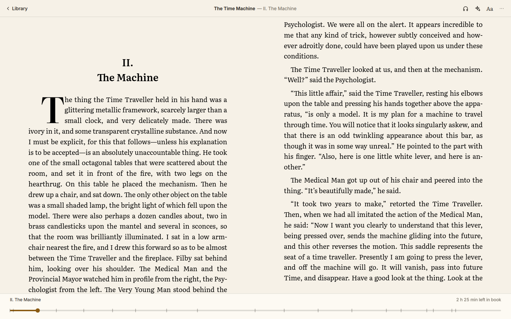
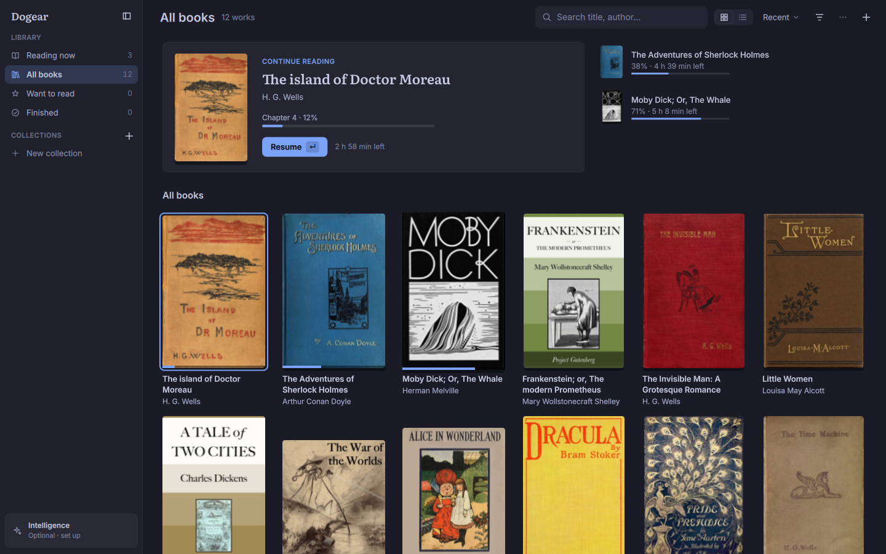

# Clothbound

A calm, local-first EPUB and PDF reader for Linux and [Omarchy](https://omarchy.org) ([clothbound.app](https://clothbound.app)): your books, academic papers, and saved web articles in one library, a quiet page to read them on, natural voices to read aloud, an adaptive Story & Study Companion, and a built-in local MCP server.

Clothbound follows your Omarchy theme, language, and window corner rounding (with **Match desktop / Rounded / Sharp** and **Light / Dark** overrides in Settings), is driven from the keyboard (and works just as well with a mouse or touchpad), and never modifies your book files.



## Contents

- [What's in v0.4.0](#whats-in-v040)
- [Intelligence: where it runs](#intelligence-where-it-runs)
- [System requirements](#system-requirements)
- [Install](#install)
- [Keyboard shortcuts](#keyboard-shortcuts)
- [CLI & MCP commands](#cli--mcp-commands)
- [Credits & License](#credits--license)

## What's in v0.4.0



- **A local-first library** for EPUBs, PDFs, and saved web articles:
  - Watched folders that keep your files untouched, edition grouping, drag-and-drop collections, cover grid & compact list views, a Continue reading hero card, and reading stats (time read, daily streak, 14-day activity). `Ctrl+B` folds the sidebar.
  - **Add from URL (`Ctrl+Shift+U`)**: paste any web article URL to save a clean, offline EPUB on your **Articles** shelf, or fetch arXiv, alphaXiv, Hugging Face Papers, and direct EPUB/PDF links straight into your library.
  - **OPDS 1.2 & 2.0 Catalogs (`Ctrl+Shift+O`)**: browse Standard Ebooks, Project Gutenberg, Open Library, arXiv, and Feedbooks — or connect your own Calibre-Web, Kavita, or Komga servers (credentials stored in the system keyring).
- **Command Palette (`Ctrl+K`)**: instant fuzzy search across book titles, **full-text passages inside every book** (local SQLite FTS5), passages close **in meaning** across indexed books, chapters, cross-book highlights & notes, page/percentage jumps, and every action (`Tab` switches between *Everything* and *This book*).
- **A calm page to read on**:
  - **EPUB**: zero-flash double-buffered spreads or scroll view, drop caps, hyphenation, margin notes beside highlights, five reading themes (*Omarchy*, *Paper*, *Sepia*, *Dusk*, *Night*), optional hardcover **page-turn sound** (auto-mutes while listening), and live typeface preview in Settings.
  - **Academic PDF craft**: theme-recolored pages with automatic white-margin cropping, **preset view modes** (`0` Fit page · `W` Fit width · `1` Actual) with live auto-refit, single-press spread navigation, **Visual Snip & Explain (`X`)** (Explain, Copy LaTeX, Extract Table, Ask…), **Zero-Jump Quick-Look Peek Card** for clickable figures & citations, and automatic **arXiv / DOI** detection with one-click **BibTeX / APA** copy.
- **Highlights, notes & bookmarks**: W3C text-quote anchoring, undo/redo, cross-book search, Obsidian/Readwise Markdown export, and `clothbound notes` on the CLI.
- **Natural read-aloud (`P`)**:
  - Adaptive **44 px / 86 px floating narration pill** with sentence highlighting, ±15 s skip, speed control, chapter scrubber, sleep timer, media keys (MPRIS), and background listening.
  - **Built-in offline voices** (Kokoro, Pocket TTS, and Piper across 42 languages — free, private, on this computer), **Gemini voices** (styles + full-cast narration with your own key), and **Studio voices** (local OpenAI-compatible TTS servers). Export offline narration as chaptered **M4B audiobooks**.
- **Adaptive Story & Study Companion (`C`)**:
  - Switch cleanly between **Story mode** (*Ask*, *Previously…*, *Who's who*, *Pictures* — strictly spoiler-free up to your current page) and **Study mode** (*Ask*, *Brief*, *Glossary* with **Smart Scope**: *Up to here* · *Whole book* · *This shelf*).
  - Renders **offline LaTeX math** (zero CDN), reads replies aloud, resizes via left-edge drag (double-click snaps to 384 px), and powers inline *Define* (offline `sdcv` StarDict or model), *Explain*, and *Translate*.
- **Built-in Local MCP Server (`clothbound-mcp`)**:
  - Standalone WebEngine-free read-only stdio JSON-RPC 2.0 server (~31 ms startup, zero Qt WebEngine/QML linkage; also accessible via `clothbound mcp`) so your local coding and research agents (Antigravity, Claude Code, Cursor, Codex) can query `list_books`, `search_library`, `search_passages`, `get_book_outline`, `read_passage`, and `list_marks` privately — one-click **Copy MCP config** in **Settings › Intelligence**.
- **Desktop craft & 50 languages**:
  - Live Omarchy theme matching, **Corners (`Match desktop | Rounded | Sharp`)** and **Reduce motion** in **Settings › General**, and 50 shipped interface languages.

## Intelligence: where it runs

Everything that uses a model is optional — Clothbound is a complete offline reader without one. Configure routing in **Settings (`Ctrl+,`) › Intelligence**:

| Feature | Cloud (Gemini) | Hybrid | This computer |
|---|---|---|---|
| Narration | Gemini voices | Local voices offline; Gemini optional | Built-in (Kokoro / Piper / Pocket) or Studio |
| Styles, Define, Translate, Who's who / Glossary | Gemini | This computer (Ollama / local server) | This computer |
| Explain, Previously / Brief, Ask, PDF Snip | Gemini | Gemini | This computer (Ollama text & vision) |
| Search by meaning | Gemini | This computer | This computer |
| Illustrate | Gemini | Gemini | Off |

Clothbound never bundles a language model or sends book text without consent. Cloud usage displays cost estimates upfront and enforces your monthly budget cap; local mode guides you through Ollama setup or detects existing `llama-server`, LM Studio, MLX, or vLLM endpoints automatically.

## System requirements

| Use case | RAM | CPU / GPU | Disk |
|---|---|---|---|
| Read, FTS5 search, marks, OPDS, MCP, offline audio playback | 4 GB | Any `x86_64` or `aarch64` | — |
| Everything with Gemini (your own API key) | 8 GB | Any | Up to 4 GB audio cache |
| Built-in offline voices (Kokoro / Piper / Pocket TTS) | 8 GB | 4+ cores (AVX2 or ARM dotprod) | 0.2–0.6 GB |
| + small local model (2–4B): Define, Translate, Glossary, embeddings | 16 GB | GPU helpful | ~5 GB |
| + larger local model (9–12B): Ask, Brief, PDF Snip vision | 32 GB (or 16 GB + 8–12 GB VRAM) | Dedicated GPU or Apple Silicon | ~12 GB |

## Install

### Arch Linux & Omarchy

One line, on x86_64 or aarch64:

```sh
curl -fsSL https://clothbound.app/install | bash
```

On x86_64 it downloads the [release package](https://github.com/orcawhisperer/clothbound/releases), verifies its checksum, and installs it with pacman; on aarch64 (for example Asahi Linux) it builds the same release from source. [Read the script](site/install.sh) first if you like.

Or build and install from a clone (binary, `.desktop` entry, and icon):

```sh
git clone https://github.com/orcawhisperer/clothbound.git
cd clothbound
./bin/install
```

### Build & test from source

Clothbound uses **CMake 3.24+** (C++20, Ninja or Unix Makefiles, Qt 6):

```sh
./bin/build           # CMake Release build -> ./build/clothbound and ./build/clothbound-mcp
./bin/test            # builds & runs the full offscreen QtTest suite (266+ tests)
./bin/test --asan     # runs tests under AddressSanitizer + UBSan
./bin/test --tsan     # runs concurrency stress tests under ThreadSanitizer
./bin/bench           # runs C++ core micro-benchmarks and headless startup/memory benchmarks
./bin/translate check # verifies all 50 translation catalogs
```

## Keyboard shortcuts

| Library | |
|---|---|
| `← → ↑ ↓` / `h j k l` | Move between books |
| `↵` | Open the book, or choose an edition |
| `Space` | Continue the book you were reading |
| `/` or `Ctrl+F` | Filter the library |
| `Ctrl+K` | Command Palette: books, full-text passages, notes, and actions |
| `Ctrl+Shift+U` · `Ctrl+Shift+O` | Add from URL · Browse OPDS catalogs |
| `I` · `S` · `G` · `V` · `A` | Details · sort · group editions · grid/list · add folder |
| `Ctrl+B` | Fold or show the sidebar |

| Reading | |
|---|---|
| `Space` `→` `l` `j` / `Shift+Space` `←` `h` `k` | Next / previous page (or spread) |
| `[` `]` | Previous / next chapter |
| `0` · `W` · `1` · `+` `−` | PDF: Fit page · Fit width · Actual size · zoom (EPUB: text size) |
| `X` | PDF: Visual Snip & Explain |
| `T` · `G` | Table of contents · go to page or percentage |
| `Tab` | Show or hide reading controls |
| `/` or `Ctrl+F`, then `n` `N` | Search in book, next / previous match |
| `B` · `M` | Toggle bookmark corner fold · highlights, notes & bookmarks |
| `C` | Toggle Story / Study Companion |
| `A` · `D` | Appearance popover · cycle reading theme |
| `Ctrl+Z` · `Ctrl+Shift+Z` | Undo · redo mark changes |
| `Esc` | Close active overlay, or return to the library |

| Listening | |
|---|---|
| `P` · `Shift+P` | Listen / pause · stop |
| `,` `.` | Previous / next paragraph |
| `<` `>` | Slower / faster |
| `V` | Choose narrator, style, full cast, or export M4B audiobook |

`Ctrl+K` opens the Command Palette anywhere, `Ctrl+,` opens Settings, `?` opens the full shortcut sheet, `F` / `F11` toggles full screen, and `Q` quits.

## CLI & MCP commands

### Standalone WebEngine-free `clothbound-mcp`

For local AI agents and fast read-only terminal queries without loading Qt WebEngine, Qt Quick, Qt QML, or Qt Multimedia, use the standalone `clothbound-mcp` binary (opens `library.sqlite` and `index.sqlite` strictly read-only with `QSQLITE_OPEN_READONLY` and `PRAGMA query_only=ON`):

```sh
clothbound-mcp [mcp]                         # run the read-only local stdio JSON-RPC 2.0 MCP server (default)
clothbound-mcp list [--json]                 # list books in the library with reading progress
clothbound-mcp search <query> [--json]       # read-only full-text FTS5 + lexical search
clothbound-mcp notes [book] [--json]         # export highlights, notes & bookmarks (one book or whole library)
clothbound-mcp --version | --help            # version and usage
```

### Full `clothbound` CLI

Every CLI command works headless without a display and supports `--json`:

```sh
clothbound [open] [book]                     # open the library, or a book where you left off
clothbound add <folder-or-book>...           # add books or folders to the library
clothbound list                              # list books with reading progress
clothbound info <book>                       # metadata and table of contents
clothbound search <query>                    # full-text search across your offline library
clothbound notes <book>                      # export highlights, notes, and bookmarks as Markdown
clothbound mcp                               # run the read-only local stdio MCP server (or use clothbound-mcp)
clothbound voices [list|install|remove|bench] # manage built-in offline voices
clothbound ai [status|key|forget|local]      # inspect Gemini usage/keys and local models
clothbound skill [install]                   # install the Clothbound skill for coding agents
```

## Credits & License

Clothbound is MIT licensed ([LICENSE](LICENSE)). It uses Qt 6 (LGPL) and Qt WebEngine, and bundles **Literata** and **Inter** under the SIL Open Font License 1.1. Built-in offline voices use [sherpa-onnx](https://github.com/k2-fsa/sherpa-onnx) (Apache-2.0) with [Kokoro](https://huggingface.co/hexgrad/Kokoro-82M) (Apache-2.0), [Pocket TTS](https://github.com/kyutai-labs/pocket-tts) (CC BY 4.0), and [Piper](https://github.com/rhasspy/piper) voices (per-voice license shown in Settings › Voices), downloaded only when requested; sherpa-onnx's `espeak-ng` component is GPL-3.0.
